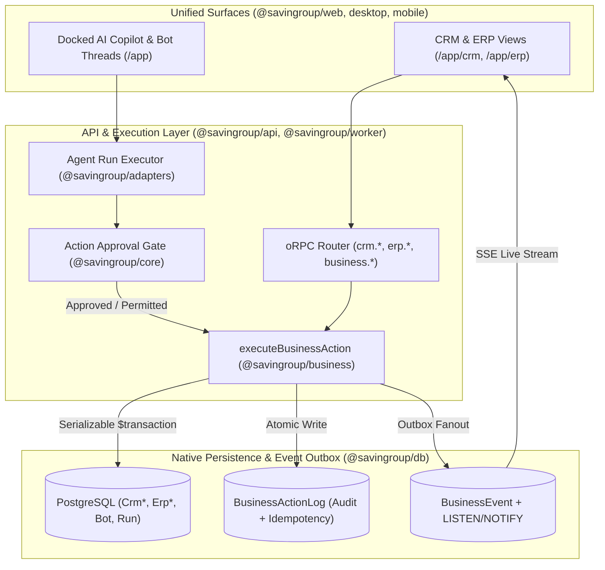

# AI-Native CRM & Business Operations Architecture

## 1. Core Architectural Tenet

**HUMAN USERS MANAGE THE BUSINESS. AI AGENTS OPERATE THE CRM.**

Every CRM and ERP operation—whether triggered by a human clicking a button in the web UI or by an AI bot executing a tool call during a conversation or scheduled routine—flows through a **single, unified execution pipeline** (`executeBusinessAction` in `packages/business/src/execute.ts`).

---

## 2. Interconnected Platform Modules

### A. CRM Core (`packages/business/src/crm/`)
- **Companies (`companies.ts`)**: Account management, domain/phone tracking, duplicate detection, and linked contacts/deals/orders.
- **Contacts (`contacts.ts`)**: Individual stakeholders linked to companies, with email/phone validation and search.
- **Leads (`leads.ts`)**: Sequential lead refs (`L-1`, `L-2`), source tracking, estimated value, assignment to humans or AI bots, qualification (`new` → `contacted` → `qualified` / `unqualified`), and atomic conversion (`crm.lead.convert`) into deals (`CrmDeal`).
- **Deals & Pipeline (`deals.ts`)**: Sequential deal refs (`D-1`, `D-2`), configurable stages (`qualification`, `proposal`, `negotiation`, `won`, `lost`), drag-and-drop Kanban board, list view, expected close date, and revenue tracking.
- **Activities & Follow-up Tasks (`activities.ts`)**: Unified activity log (`call`, `email`, `meeting`, `note`, `follow_up`). Any `follow_up` with a `dueAt` timestamp acts as an assignable task with completion tracking (`completedAt`) and overdue detection.

### B. AI Agent Operations (`packages/business/src/team.ts` & `tools.ts`)
- Persistent digital employees (`Bot`) provisioned per workspace (`Space`) with role-scoped tool allowlists (`disabledBuiltinTools`) and workspace-level approval rules (`ActionApprovalRule`).
- Docked contextual AI Assistant (`apps/web/src/components/business/assistant.tsx`) that shares the bot's main thread, receives the focused record context (`Lead L-1`, `Deal D-2`, etc.), streams tool execution and approval cards, and triggers live UI refreshes upon completion.

### C. Business Operations / ERP (`packages/business/src/erp/`)
- **Products & Catalog (`products.ts`)**: SKU-keyed catalog with deterministic `Decimal(14, 2)` unit pricing and active flags.
- **Inventory Ledger (`inventory.ts`)**: Stock-on-hand checks (`erp.inventory.check`) and immutable adjustments (`ErpInventoryAdjustment`) enforcing workspace negative-stock policy (`BusinessSettings.allowNegativeStock`).
- **Sales Orders / Quotations (`orders.ts`)**: Multi-line draft creation (`SO-1`), deterministic line/subtotal math (`packages/business/src/money.ts`), approval requests (`erp.order.request_approval`), owner approval (`erp.order.approve`), and confirmation (`erp.order.confirm`) which atomically deducts stock and marks the linked CRM deal `won`.
- **Invoices & Payments (`invoices.ts`)**: Draft creation from confirmed orders (`INV-1`), issuance (`erp.invoice.issue`), and payment recording (`erp.invoice.record_payment`) updating `unpaid` / `partial` / `paid` status.

### D. Workflow & Routine Automation (`packages/core/src/cron.ts` & `apps/worker`)
- Scheduled routines (`Routine`) with cron expressions, timezone awareness, inbound webhooks, and event-driven triggers (`ticket_assigned`, `routine`, `follow_up`) executed by `apps/worker` using `GraphileJobWorkerHost`.

### E. Analytics & Reporting (`packages/business/src/crm/overview.ts` & `erp/overview.ts`)
- Deterministic PostgreSQL aggregations for pipeline value, win rate, stage distribution, open leads, overdue follow-ups, monthly confirmed sales, unpaid invoices, and low-stock alerts.

---

## 3. Native-First, Zero-Docker Operation

1. **Database**: Standard native PostgreSQL connection (`DATABASE_URL`).
2. **Worker Queue**: `graphile-worker` running inside `apps/worker` against the same PostgreSQL database (or `WAKEUP_DRIVER=memory` for lightweight single-process tests).
3. **Agent Tool Execution**: All 37 `crm_*`, `erp_*`, and `admin_*` tools execute in-process via `runBusinessTool` (`packages/business/src/tools.ts`) against Prisma—no container or VM sandbox is needed.
4. **Sandbox Provider**: Defaults to `SANDBOX_PROVIDER=none` (or `SANDBOX_PROVIDER=desktop` for host-isolated file/command workspaces under `<DATA_DIR>/desktop-computers/<botId>`), completely eliminating any dependency on Docker Engine or `/var/run/docker.sock`.
