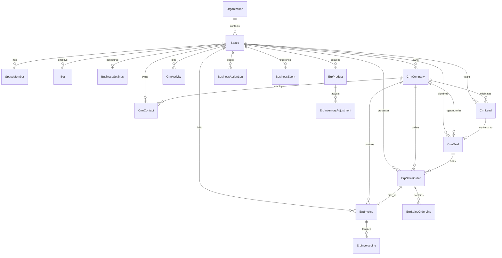

# Canonical CRM & Business Operations Data Model

## 1. Entity-Relationship Overview

All CRM and ERP entities live in `packages/db/prisma/schema.prisma` and are strictly scoped to a workspace (`Space`) via `spaceId`.

---

## 2. Canonical Table Specifications

### 2.1 Workspace & Policy Configuration (`BusinessSettings`)
- **Primary Key**: `id` (`cuid()`), unique on `spaceId`.
- **Policy Columns**:
  - `currency`: ISO 4217 3-letter currency code (default `"USD"`).
  - `allowNegativeStock`: `Boolean` (default `false`).
  - `orderApprovalRequired`: `Boolean` (default `true`).
  - `invoiceApprovalRequired`: `Boolean` (default `true`).
- **Sequential Numbering Counters** (atomically incremented inside serializable transactions):
  - `nextLeadNumber` (`L-<n>`), `nextDealNumber` (`D-<n>`), `nextOrderNumber` (`SO-<n>`), `nextInvoiceNumber` (`INV-<n>`).

### 2.2 CRM Core Entities

1. **`CrmCompany` (`crm_companies`)**
   - `id`, `spaceId`, `name`, `domain`, `phone`, `notes`, `createdByUserId`, `createdByBotId`, `createdAt`, `updatedAt`.
   - Indexed on `[spaceId, name]`.
2. **`CrmContact` (`crm_contacts`)**
   - `id`, `spaceId`, `firstName`, `lastName`, `email`, `phone`, `title`, `notes`, `companyId`, `createdByUserId`, `createdByBotId`, `createdAt`, `updatedAt`.
   - Indexed on `[spaceId, email]`, `[spaceId, companyId]`, `[spaceId, lastName, firstName]`.
3. **`CrmLead` (`crm_leads`)**
   - `id`, `spaceId`, `number` (`@@unique([spaceId, number])`), `title`, `status` (`new` | `contacted` | `qualified` | `unqualified` | `converted`), `source`, `notes`, `value` (`Decimal(14, 2)`), `companyId`, `contactId`, `assigneeUserId`, `assigneeBotId`, `convertedDealId` (`@unique`), `createdByUserId`, `createdByBotId`, `createdAt`, `updatedAt`.
   - Indexed on `[spaceId, status, updatedAt]`, `[spaceId, assigneeBotId]`, `[spaceId, assigneeUserId]`.
4. **`CrmDeal` (`crm_deals`)**
   - `id`, `spaceId`, `number` (`@@unique([spaceId, number])`), `title`, `stage` (`qualification` | `proposal` | `negotiation` | `won` | `lost`), `amount` (`Decimal(14, 2)`), `currency`, `expectedCloseAt`, `closedAt`, `notes`, `companyId`, `contactId`, `ownerUserId`, `ownerBotId`, `createdByUserId`, `createdByBotId`, `createdAt`, `updatedAt`.
   - Indexed on `[spaceId, stage, updatedAt]`, `[spaceId, companyId]`.
5. **`CrmActivity` (`crm_activities`)**
   - `id`, `spaceId`, `kind` (`call` | `email` | `meeting` | `note` | `follow_up`), `subject`, `body`, `dueAt`, `completedAt`, `companyId`, `contactId`, `leadId`, `dealId`, `assigneeUserId`, `assigneeBotId`, `createdByUserId`, `createdByBotId`, `createdAt`, `updatedAt`.
   - Indexed on `[spaceId, createdAt]`, `[spaceId, leadId]`, `[spaceId, dealId]`, `[spaceId, contactId]`, `[spaceId, completedAt, dueAt]`.

### 2.3 Business Operations & ERP Entities

1. **`ErpProduct` (`erp_products`)**
   - `id`, `spaceId`, `sku` (`@@unique([spaceId, sku])`), `name`, `description`, `unitPrice` (`Decimal(14, 2)`), `currency`, `active`, `stockOnHand` (`Int`), `createdByUserId`, `createdByBotId`.
2. **`ErpInventoryAdjustment` (`erp_inventory_adjustments`)**
   - `id`, `spaceId`, `productId`, `delta`, `quantityAfter`, `reason`, `orderId`, `createdByUserId`, `createdByBotId`, `createdAt`.
3. **`ErpSalesOrder` (`erp_sales_orders`) & `ErpSalesOrderLine` (`erp_sales_order_lines`)**
   - Header: `id`, `spaceId`, `number` (`@@unique([spaceId, number])`), `status` (`draft` | `pending_approval` | `approved` | `confirmed` | `cancelled`), `currency`, `subtotal` (`Decimal(14, 2)`), `notes`, `companyId`, `contactId`, `dealId`, `approvalRequestedAt`, `approvedAt`, `approvedByUserId`, `approvedByBotId`, `confirmedAt`, `cancelledAt`.
   - Lines: `id`, `spaceId`, `orderId`, `productId`, `position`, `description`, `quantity`, `unitPrice` (`Decimal(14, 2)`), `lineTotal` (`Decimal(14, 2)`).
4. **`ErpInvoice` (`erp_invoices`) & `ErpInvoiceLine` (`erp_invoice_lines`)**
   - Header: `id`, `spaceId`, `number` (`@@unique([spaceId, number])`), `status` (`draft` | `issued`), `paymentStatus` (`unpaid` | `partial` | `paid`), `currency`, `subtotal`, `total`, `amountPaid`, `orderId` (`@unique`), `companyId`, `issuedAt`, `dueAt`, `paidAt`, `approvedByUserId`, `approvedByBotId`.

### 2.4 Audit Trail, Idempotency & Event Outbox

1. **`BusinessActionLog` (`business_action_log`)**
   - Every write operation inserts a row inside the same database transaction as the mutation.
   - `@@unique([spaceId, idempotencyKey])` guarantees that retried API requests or resumed agent tool runs return the committed outcome (`replayed: true`) instead of duplicating records.
   - Tracks `actionId`, `actionVersion`, `recordType`, `recordId`, `actorUserId`, `actorBotId`, `runId`, `outcome` (`succeeded` | `failed`), `errorCode`, `input`, and `result`.
2. **`BusinessEvent` (`business_events`)**
   - Transactional domain event outbox (`type`, `recordType`, `recordId`, `payload`, `actorUserId`, `actorBotId`, `runId`, `publishedAt`).

---

## 3. Actor Attribution Design

Actor fields (`createdByUserId`, `createdByBotId`, `assigneeUserId`, `assigneeBotId`, `ownerUserId`, `ownerBotId`, `approvedByUserId`, `approvedByBotId`) store plain IDs intentionally and are resolved at read time via `packages/business/src/attribution.ts`. This ensures that archiving or deleting a bot or removing a user never corrupts historical CRM/ERP audit trails or financial documents.
