# Savingroup interview summary and study guide

This guide describes the code in this checkout. It separates implemented behavior from design discussion and suggested exercises. It is not a claim that you personally authored the entire repository. In interviews, explain your actual contributions and demonstrate what you understand.

## 1. Your project introduction

**30-second answer**

Savingroup is an open-source platform for persistent AI teammates. Users create bots that retain conversations and memory, run scheduled routines, use tools and computers, and connect to external applications. The product has React web, Electron desktop, and Expo mobile clients backed by a shared TypeScript API, PostgreSQL database, and background worker. Its defining architectural choice is to keep model, sandbox, memory, and integration providers replaceable.

**Two-minute answer**

Savingroup extends chat into long-running work. A bot has identity, history, memory, and access to configured capabilities. The frontend sends user intent to a Hono API through shared oRPC contracts. The backend checks access and persists work. A Graphile Worker process executes jobs through an agent runtime and provider interfaces. Database-backed events let clients receive updates and catch up after reconnecting.

The monorepo shares domain logic, contracts, persistence, adapters, and UI packages across applications. Electron hosts the web interface; mobile uses native navigation and interactions while sharing the backend and reusable behavior.

The difficult engineering problems are recovery after worker failure, duplicate delivery, external side effects, concurrent access to computers, and protecting credentials. The code addresses these with explicit run states, leases and fencing, effect records, reconciliation, authorization checks, and encrypted credential storage. I would demonstrate a message becoming a run, inspect its events, and explain what happens if execution is interrupted.

## 2. What the product does

| Capability | Meaning |
| --- | --- |
| Persistent bots | Conversations, routines, memory, and history survive individual interactions. |
| Computer use | Bots can use browser, terminal, files, and graphical desktop capabilities. |
| Team and Private computers | Shared working environments or isolated computer environments, depending on the selected mode. |
| Delegation | Bots can delegate to peers or short-lived subagents. |
| Model connections | Users connect supported model providers; local compatible endpoints are also configurable. |
| Integrations | Optional managed catalogs and installed MCP/OpenAPI sources expose application tools. |
| Voice and messaging | Optional adapters connect speech and external messaging surfaces. |
| Self-hosting | The core architecture does not require one hosted vendor. |

Do not imply that every optional capability works without configuration, that inference is free, or that this beta has proven production scale.

## 3. Architecture you should draw

```mermaid
flowchart TD
  Web[React web UI] --> API[Hono API and oRPC]
  Desktop[Electron hosts web UI] --> Web
  Mobile[Expo mobile client] --> API
  API --> Auth[Better Auth and access checks]
  API --> DB[(PostgreSQL / Prisma)]
  API --> Jobs[Graphile job publishing]
  Jobs --> Worker[Worker / run executor]
  Worker --> DB
  Worker --> Runtime[Agent runtime / Pi]
  Worker --> Providers[Sandbox, connectors, memory, artifacts]
  DB --> Events[Persisted events and realtime fanout]
  Events --> API
  API --> Clients[Client event subscriptions]
```



Graphile uses PostgreSQL; the jobs box is a logical responsibility, not a separate message-broker service. The diagram simplifies optional routes and in-process test wiring.

| Location | Responsibility | Study first |
| --- | --- | --- |
| `apps/web` | React 19, Vite, routing, UI and API client | `src/lib/rpc.ts`, `src/lib/auth.ts` |
| `apps/api` | HTTP transport, authentication integration, RPC handlers, composition | `src/index.ts`, `src/app.ts`, `src/router.ts` |
| `apps/worker` | Builds runtime dependencies and runs jobs/reconciliation | `src/index.ts` |
| `apps/desktop` | Electron shell and local-stack/server connection | Package scripts and main-process entry points |
| `apps/mobile` | Expo client with native interactions | App routes and `lib` |
| `packages/contracts` | Shared schemas, domain types and RPC contracts | `src/rpc.ts`, `src/domain.ts`, `src/events.ts` |
| `packages/core` | Reusable rules and state helpers | `src/run-state.ts`, `src/action-approval.ts` |
| `packages/adapter-kit` | Provider interfaces | `src/interfaces.ts` |
| `packages/adapters` | Concrete providers and execution orchestration | `src/executor.ts`, `src/job-reconciler.ts` |
| `packages/db` | Prisma schema, database operations and durable events | `prisma/schema.prisma`, `src/events.ts` |
| `packages/auth` | Shared authentication setup | `src` |
| `packages/memory` | Memory implementation | `src` |
| `packages/ui-web`, `ui-tokens`, `chat-ui` | Shared components, theme tokens and chat behavior | Package exports |
| `packages/testkit` | Emulators, integration journeys and verification harnesses | `src/cli` |
| `infra` | Compose services, sandbox runtime and supervisor | `compose/docker-compose.yml` |

## 4. Trace a message from click to completion

1. A client submits intent through the typed RPC client.
2. The API authenticates the session and checks access to the relevant space and resource. Authentication alone is insufficient.
3. Database operations persist messages and run state. Read `sendUserMessage` in `packages/db/src/events.ts` to inspect the transaction boundary.
4. The API publishes a continuation job. Durable queued work and the reconciler let the system repair missed wakeups; the queue notification is not the only record of work.
5. The worker claims work and executes it through the shared executor. Run ownership includes lease information and a fence value.
6. The runtime produces responses and tool requests. Adapters translate provider-neutral operations into concrete services or sandbox operations.
7. Events and messages record progress. The API subscription follows thread events from a cursor and streams updates to clients.
8. Execution may complete, fail, be cancelled, or pause for input/takeover. Recovery and continuation follow explicit state rules.

Practice drawing this from memory and locating each step in the code. A normal assistant response does not necessarily need every optional tool provider.

## 5. Database concepts

| Entity group | Purpose |
| --- | --- |
| User, Session, Account | Identity and authentication records. |
| Organization, Member, Space, SpaceMember | Membership and collaboration scope. |
| Bot, ChatGroup, Thread, Message | Agents and conversation structure. |
| Task, Run, Attempt, SteeringMessage | Requested work, execution, attempts, and follow-up input. |
| Event | Ordered durable progress records per thread. |
| ExternalEffect | External action request/result and idempotency tracking. |
| Routine | Scheduled or triggered work. |
| Computer, ComputerExecutionLease, AgentHome | Computer allocation, ownership, and persistent workspace metadata. |
| MemoryDocument, MemoryRevision | Stored memory and revisions. |
| Connection, Secret, McpServer | Integration configuration and credential-related records. |
| Artifact, UsageRecord | Outputs and usage accounting. |

Concrete details worth remembering:

- `Event` has a unique constraint on `(threadId, seq)`, supporting ordered per-thread replay.
- `Run` contains `leaseOwner`, `leaseFence`, `leaseExpiresAt`, `checkpoint`, and `clientNonce`.
- `ExternalEffect` has a unique `idempotencyKey`. This supports deduplication; it does not prove exactly-once execution across arbitrary external APIs.
- A `Thread` can reference a bot, group, or external conversation. Do not model every thread as a single-bot chat.
- Check actual constraints and access-query code before claiming an invariant. TypeScript types do not replace database constraints.

## 6. Reliability: your strongest technical discussion

### Run states

From `packages/core/src/run-state.ts`:

```text
queued -> leased -> running -> completed / failed / cancelled
                    |
                    +-> waiting_input / waiting_takeover
```

The diagram is simplified. Paused states can return to queued or leased; leased work can return to queued; running can return to leased; failed work can be requeued. Completed and cancelled states have no outgoing transitions in this helper. Read the transition table before discussing a specific recovery path.

### Leases and fencing

A lease gives one worker temporary ownership. Expiry permits recovery if that worker disappears. A fence is a monotonically advancing ownership generation. A stale worker must fail the ownership checks before committing protected writes after another worker takes over.

**Interview example:** Worker A stalls, its lease expires, worker B claims execution, and A returns late. Checking only whether A once owned the run is unsafe. The current owner/fence must still match. Inspect database write guards and executor tests to explain which operations are protected.

### Reconciliation

`job-reconciler.ts` periodically checks durable state to repair missing work. Its default interval is 30 seconds. PostgreSQL advisory-lock leadership limits active reconciliation leadership across worker processes. This addresses the gap where database state commits but publishing a wakeup fails.

### Durable events

`packages/db/src/events.ts` exposes `follow(threadId, cursor, signal)`. Events are persisted and followed from a cursor; realtime notifications accelerate delivery. Durable replay and catch-up matter because a notification alone can be missed. Do not describe this as complete event sourcing: the application also maintains relational state directly.

### External effects

Retries are particularly dangerous around actions such as sending a message. Persisting intent and an idempotency key helps avoid duplicate actions. If the remote side succeeds but the response is lost, outcome can be uncertain. Provider support and reconciliation determine safe recovery; blindly replaying all tool calls is wrong.

## 7. Provider architecture and AI concepts

`packages/adapter-kit/src/interfaces.ts` defines boundaries such as `SandboxProvider`, `AgentRuntime`, `MemoryStore`, `SemanticMemoryProvider`, `ConnectorProvider`, `JobPublisher`, `JobWorkerHost`, `SecretStore`, and `RealtimeFanout`.

The API and worker composition roots choose implementations. Vendor translation belongs in adapters; core behavior should not depend directly on a particular vendor SDK.

### Model selection layers

A run uses the most specific layer that names a model. `runModelChoice`, `conversationModelChoice` and `selectConfiguredModel` in `packages/adapters/src/model-selection.ts` implement the order:

| Layer | Stored on | Applies to |
| --- | --- | --- |
| Run pin | `Run.modelPinned` plus the run's model columns | A routine or inbound delivery that chose its own model. Editing the routine later cannot move a waiting run. |
| Group | `ChatGroup.modelProvider`, `modelId`, `thinkingLevel` | Every member while it replies in that group. |
| Bot | `Bot.modelProvider`, `modelId`, `thinkingLevel` | The bot's own thread, and groups without a model. |
| Space default | `SpaceModelPreference` for each member | Anything without an override. |
| Deployment default | `DeploymentSettings` and the `PI_DEFAULT_*` environment | Spaces where the member has connected no model. |

Credentials belong to a user (`UserModelCredential`, encrypted in `Secret`), not to a bot or group. An override whose provider the member has not connected falls back to the space default instead of borrowing another credential; a pinned run fails instead, because its choice was explicit. Ordered backup models (`SpaceBackupModel`) take over when the chosen provider fails during a run. The AI data-sharing check resolves the same layers, so consent covers the providers that will actually receive the data.

**How to add a provider:** identify the existing interface, implement its lifecycle and error/cancellation behavior, translate capability differences honestly, wire selection in the composition root, and add deterministic conformance tests. Avoid inventing an interface for every internal helper.

Learn these distinctions:

- **Model versus runtime:** the model generates output; the runtime manages the interaction loop and tool round trips.
- **Tool call versus action authorization:** model output proposes work; trusted backend code decides whether and how to execute it.
- **History versus memory:** conversation history records interactions; persistent memory stores reusable information. External semantic retrieval is an optional boundary, not a prerequisite for all memory.
- **Sandbox versus persistence:** a machine can be replaced while its portable workspace is restored.
- **Deterministic tests versus model quality:** fixtures can verify streaming, tool handling and recovery; they cannot establish real-model judgment or task-success rates.

## 8. Security and computer isolation

Explain security in terms of code boundaries:

- Better Auth supplies authentication; backend membership/resource checks supply authorization.
- `EncryptedSecretStore` uses AES-256-GCM, per-record salt and IV, scrypt key derivation, and authenticated record identity for its current versioned format. See `packages/adapters/src/secrets.ts`.
- Credentials should stay out of frontend responses, logs, fixtures and public diffs.
- Screen access uses protected proxy capabilities. Inspect `apps/api/src/screen-proxy.ts` and the web proxy before discussing expiry and validation details.
- Team screens are not independent security boundaries for mutually untrusted workloads. Study the explicit sharing model in `docs/computer-runtime.md`.
- Trusted local-computer execution has a different risk model from an isolated environment.
- External tool results and page text are untrusted input; they must not replace backend authorization.

The portable workspace is the durable computer boundary. `LocalAgentHomeStore` retains the latest workspace and checkpoint metadata; it is not an immutable full-machine snapshot archive. Changes outside that workspace may not survive replacement. Database and workspace storage both matter for backups.

## 9. Frontend interview points

React clients render state and express user intent. Backend orchestration avoids three clients implementing incompatible authorization, retries or provider behavior.

Electron reuses the web UI. Expo uses native navigation, sheets, menus, permissions and storage where appropriate. Shared behavior belongs in packages, but sharing every visual component would undermine native interaction patterns.

Semantic theme tokens live in `packages/ui-tokens`; web primitives live in `packages/ui-web`. Reuse these rather than hardcoding colors or rebuilding controls. The product favors minimal visible copy and progressive disclosure.

Practice explaining subscription cleanup, reconnect cursors, duplicate-event handling, optimistic updates, loading/error states, accessible controls, and cancellation. Locate the implementation before claiming a particular strategy is used everywhere.

## 10. Testing strategy

| Command | What it verifies | Prerequisite |
| --- | --- | --- |
| `pnpm test` | Default unit/property/in-process contract suite | Supported Node and dependencies |
| `pnpm check` | TypeScript across packages | Dependencies and generated client where needed |
| `pnpm lint` | Biome formatting and lint rules | Dependencies |
| `pnpm test:integration` | Real PostgreSQL journeys and queue/realtime behavior | Docker |
| `pnpm test:e2e` | Browser journeys with emulated providers | Docker |
| `pnpm test:pi` | Real runtime against a local model fixture | No live model credentials |
| `pnpm test:topology` | Docker computer and worker recovery | Docker |
| `pnpm test:evals --list` | Available agent-quality evaluation cases | See harness requirements |

Do not routinely run desktop E2E on a maintainer's machine; the repository reserves that real-window suite for CI verification. Live-provider checks are separate and can require credentials and billable resources.

Good tests target behavior: stale owners cannot commit, reconnects recover events, duplicate input does not duplicate work, cross-space access fails, uncertain side effects are handled safely, and replacement computers restore durable files.

## 11. Common interview questions and answer outlines

1. **Why a monorepo?** Shared contracts, rules, UI and adapters keep clients consistent. Tradeoffs include dependency discipline and broader build/test coordination.
2. **Why a worker process?** Long-running work outlives HTTP requests and UI sessions. It also introduces ownership, queue delivery and recovery problems that must be handled explicitly.
3. **Why PostgreSQL plus Graphile?** This implementation keeps relational state and durable jobs in PostgreSQL, reducing the number of core services. Database load and connection management remain scaling concerns.
4. **What happens after a worker crash?** Durable run state remains; lease/reconciliation mechanisms enable recovery. External effects require separate reasoning about whether work already happened.
5. **Why not retry everything?** Reads and idempotent writes differ from irreversible external actions. A timeout does not prove failure at the destination.
6. **How does reconnect work?** Clients follow persisted thread events using a cursor. Realtime fanout improves latency while catch-up handles missed notifications.
7. **Does the system guarantee exactly-once execution?** Do not make that blanket claim. Explain deduplication, ownership checks and provider-dependent effects separately.
8. **How are secrets protected?** Encrypted records, server-side use, limited exposure and guarded output. Encryption does not replace authorization or careful key handling.
9. **How would you add a sandbox provider?** Implement the shared contract, lifecycle, workspace transfer and capability translation, then prove behavior with offline conformance tests.
10. **What is the hardest concurrency case?** A stale worker returning after takeover, or concurrent bots sharing a computer while a checkpoint or human takeover is requested.
11. **How would you scale it?** First measure queue delay, run duration, database load and subscription behavior. Then evaluate worker concurrency, connection pooling and shared storage. These are proposals, not measured results from this checkout.
12. **What would you improve?** Pick a demonstrated problem, define a metric, propose the smallest change, and describe failure tests. Avoid speculative rewrites.
13. **What did you personally build?** State only your actual work. Distinguish repository study, a local extension and original authorship.
14. **Why are model tests insufficient?** Plumbing correctness and agent decision quality are different. Use deterministic fixtures for the first and explicit evaluation cases for the second.
15. **What happens when a computer is replaced?** Restore the portable workspace through the provider boundary. Do not promise recovery of arbitrary OS-level changes.

## 12. Seven-day study plan

Budget approximately two focused hours a day. Spend more time tracing one feature than memorizing framework definitions.

| Day | Study and practice | Deliverable |
| --- | --- | --- |
| 1 | Read README, package scripts, entry points; explain the user problem | A recorded 30-second and two-minute introduction |
| 2 | Trace RPC client to API handler and membership checks | A message-flow diagram with actual function names |
| 3 | Study schema, transactions, run states, leases and fencing | Explain a worker-crash timeline on paper |
| 4 | Read executor and one sandbox/connector interface plus its tests | Explain how to add a provider without changing core behavior |
| 5 | Study events, subscriptions, frontend state and shared/native boundaries | Explain reconnect and cancellation end to end |
| 6 | Study secrets, approvals, isolation and test harnesses | Five failure scenarios and the tests that should catch them |
| 7 | Rehearse a demo and answer the questions above aloud | A ten-minute mock interview and a list of remaining gaps |

For every file, ask: What enters? What leaves? What state changes? What can fail? Who owns recovery? What test proves the behavior?

## 13. Practical exercises

These are suggestions, not changes already implemented:

1. Run a focused existing state-machine test and explain one prohibited transition.
2. Follow one event type from backend emission to client rendering.
3. Use an existing emulator to demonstrate a tool failure without calling a real provider.
4. Trace how a space access check rejects an unauthorized resource request.
5. Add a small, justified regression test for a behavior you can explain, then make a narrow fix if you find a real bug.

Keep a contribution log: problem, reproduction, change, test, result. That produces an honest interview story with evidence.

## 14. Local run checklist and demo

The supported source-development setup requires Node `^22.22.2 || ^24.0.0 || >=26.0.0`, pnpm 9, and Docker for the documented PostgreSQL and computer setup.

Preserve an existing `.env`. For a fresh setup, copy `.env.example` and set independent random values for `BETTER_AUTH_SECRET`, `ENCRYPTION_KEY`, `SCREEN_PROXY_SECRET`, and `SANDBOX_SUPERVISOR_TOKEN`. Never paste real values into interview notes.

From the repository root, after prerequisites are available:

```powershell
docker compose --env-file .env -f infra/compose/docker-compose.yml up postgres -d
pnpm install
pnpm db:generate
pnpm db:migrate
pnpm sandbox:build
pnpm dev
```

Open `http://127.0.0.1:5173`. The default API port is 3100, PostgreSQL host port is 5433, and supervisor port is 7091. Create an account, connect a model, create a bot, and try a small task. A frontend HTTP response alone does not prove that authentication or agent execution works.

For a host-run supervisor with local Docker Desktop, consult `.env.example` for `SANDBOX_CONTROL_VIA_LOOPBACK=true`. Do not enable it indiscriminately for other topologies.

Once the backend is running, Electron can be launched with `pnpm --filter @savingroup/desktop dev`; select Existing instance and the local web URL. Consult `docs/mobile-release.md` for mobile setup.

**Five-minute demo:** introduce the problem, show a bot and thread, submit one small configured task, explain the event/run path, then show the relevant state-machine test. Only demonstrate computer use after its sandbox is verified. Use fake demo data and avoid exposing credentials or account details.

Avoid `pnpm compose:down` when you want to retain local database data: the current script includes `down -v`, which removes Compose volumes.

## 15. Final revision checklist

- Explain the product without listing libraries first.
- Draw the architecture and name one real file for each layer.
- Trace message creation, job execution, and event delivery.
- Explain leases, fencing, reconciliation and idempotency with failure examples.
- Separate authentication from authorization and model requests from permitted actions.
- Describe provider boundaries and workspace durability accurately.
- Know which tests require Docker and which use offline fixtures.
- Distinguish implemented capabilities, personally completed work, and proposed improvements.
- Never invent performance numbers, user counts, quality scores or production guarantees.

Primary repository references: [README](../README.md), [contribution workflow](../CONTRIBUTING.md), [computer runtime](computer-runtime.md), [agent verification](agent-verification.md), and [self-hosting](self-host.md).
